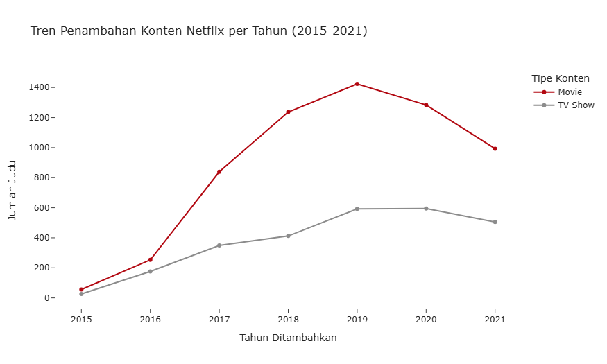
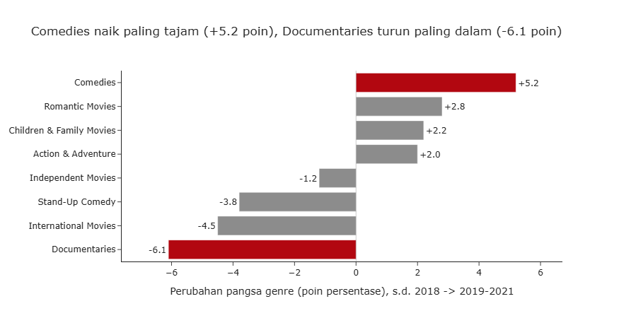
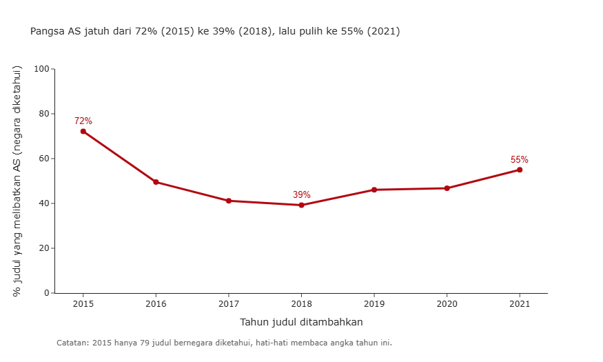
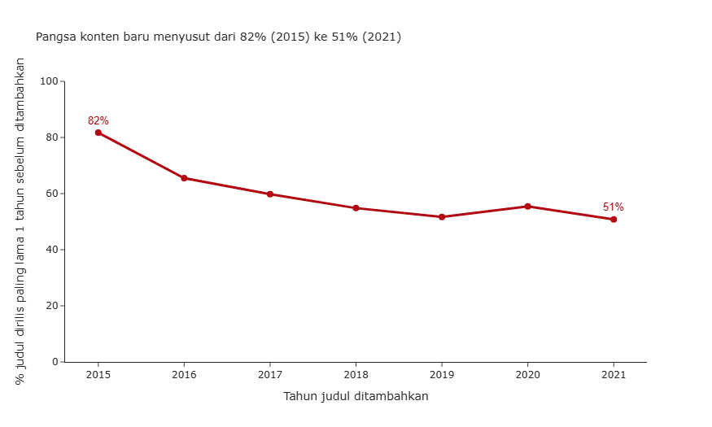

# Analisis Katalog Netflix: Komposisi, Pergeseran Strategi Konten, dan Batasannya

Analisis eksplorasi terhadap 8.807 judul di katalog Netflix untuk memahami apa yang ada di katalog, bagaimana komposisinya berubah dari tahun ke tahun, dan hipotesis apa yang layak diuji lebih lanjut. Semua rekomendasi di sini berstatus **hipotesis**, karena data hanya mengukur isi katalog, bukan perilaku penonton.

**Tools:** Python (pandas, numpy, matplotlib, seaborn, plotly)

## Pertanyaan bisnis

1. Seperti apa komposisi katalog Netflix (film vs serial, negara, genre, rating)?
2. Bagaimana strategi konten berubah dari tahun ke tahun?
3. Hipotesis apa yang layak diuji untuk arah pertumbuhan berikutnya?

## Temuan utama

**1. Katalog bertumpu pada film, tetapi pola tiap negara sangat berbeda.**
Film mencakup 69,6% katalog dan serial 30,4%. Amerika Serikat terlibat di 3.690 judul (41,9%), disusul India (1.046) dan Inggris (806). Porsi film per negara: India 92,0%, AS 74,6%, dan Inggris 66,3%. Inggris adalah yang paling seimbang, dengan serial 33,7%.

**2. Penambahan judul memuncak di 2019, lalu melambat.**
Total judul yang ditambahkan naik dari 429 (2016) ke 2.016 (2019), lalu turun ke 1.879 (2020). Film turun dari 1.424 ke 1.284, sedangkan serial bertahan di sekitar 595. Data 2021 berhenti di 25 September, jadi angka 2021 tidak bisa dibaca sebagai tren.

**3. Komposisi genre bergeser.**
Dibandingkan periode sampai 2018, pada 2019-2021 pangsa komedi naik paling tajam (15,8% menjadi 21,0%, atau +5,2 poin). Dokumenter turun dari 13,6% ke 7,5% dan stand-up dari 6,2% ke 2,4%, sementara pangsa dokumenter serial (docuseries) stabil di 4,5%.

## Visualisasi









## Hipotesis dan rekomendasi

| Temuan | Hipotesis / rekomendasi | Data yang dibutuhkan untuk menguji |
|---|---|---|
| Komedi naik, dokumenter dan stand-up turun | Uji dulu apakah volume komedi sebanding dengan jam tonton sebelum menambah atau mengurangi produksi per genre | Jam tonton per genre |
| Konten Nigeria naik dari 4 judul (sampai 2018) ke 99 judul (2019-2021), 1,2% dari katalog, 91% berupa film | Layak menjadi kandidat studi kelayakan, bukan keputusan investasi | Data pelanggan dan populasi per negara |
| Pangsa konten baru (dirilis paling lama 1 tahun sebelum ditambahkan) turun dari 82% (2015) ke 51% (2021) | Evaluasi nilai katalog lama, karena belum jelas apakah katalog lama ditonton | Jam tonton per judul |

## Kehati-hatian dalam membaca data

Beberapa pola pada data ini mudah disalahartikan, dan saya memilih untuk tidak menjadikannya kesimpulan:

- **Mesir bukan bukti produksi lokal yang tumbuh.** 106 dari 113 judul ditambahkan hanya pada 2019-2020, dengan median tahun rilis 2012. Pola ini lebih mirip pembelian satu paket pustaka film lama.
- **"Pasangan aktor" teratas bukan kemitraan kreatif.** Pasangan teratas berasal dari satu kelompok serial animasi anak India (misalnya Chhota Bheem).
- **Peringkat sutradara tidak dibuat.** 2.634 baris tidak memiliki sutradara, termasuk 91% serial.
- **Pertumbuhan tinggi pada basis kecil menyesatkan.** Kelipatan pertumbuhan Nigeria (sekitar 25 kali) berasal dari basis 4 judul.

## Batasan data

- Data adalah katalog (supply), bukan perilaku penonton (demand).
- Data berhenti di 25 September 2021.
- Hanya mencakup judul yang masih tayang saat data diambil, sehingga ada bias penyintas (survivorship bias).
- Tidak ada penanda konten original atau lisensi, jadi tidak bisa diuji apakah perubahan komposisi mencerminkan strategi original.
- Kolom negara kosong pada sebagian judul, dan kolom sutradara dan pemeran juga banyak yang kosong.

## Data cleaning

- 3 baris memiliki durasi yang salah masuk ke kolom `rating`, lalu dipindahkan ke `duration`.
- `date_added` diubah menjadi datetime dan dipecah menjadi tahun dan bulan.
- Nilai kosong pada `director`, `cast`, `country`, dan `rating` diisi "Unknown" agar baris tetap terhitung, lalu dikeluarkan saat membuat peringkat.
- `duration` dipisah menjadi nilai numerik dan satuan (menit atau season).
- Kolom multi-nilai (`country`, `listed_in`, `cast`, `director`) dipecah dengan split lalu explode.

## Cara menjalankan

1. Unduh repo ini (Code, lalu Download ZIP) atau gunakan `git clone`.
2. Instal library:
   ```
   pip install pandas numpy matplotlib seaborn plotly kaleido
   ```
3. Unduh `netflix_titles.csv` dari halaman dataset (lihat bagian Sumber data) dan letakkan di folder yang sama dengan notebook.
4. Buka `EDA_Netflix.ipynb` dan jalankan semua sel.

## Struktur repo

```
.
netflix-catalog-eda/
├── EDA_Netflix.ipynb
├── README.md
└── images/
    ├── tren_tahunan.png
    ├── pergeseran_genre.png
    ├── pangsa_as.png
    └── konten_baru.png
```
## Sumber data

There are so many datasets under the topic netflix analysis. From that, we have selected a dataset "Netflix Movies and TV shows" based on the fact that more the rows the more data we can infer. This dataset consists of tv shows and movies available on Netflix as of 2020.This dataset consists of tv shows and movies available on Netflix as of 2019. The dataset is collected from Fixable which is a third-party Netflix search engine.
The Netflix Movies and TV Shows dataset link - https://www.kaggle.com/shivamb/netflix-shows
